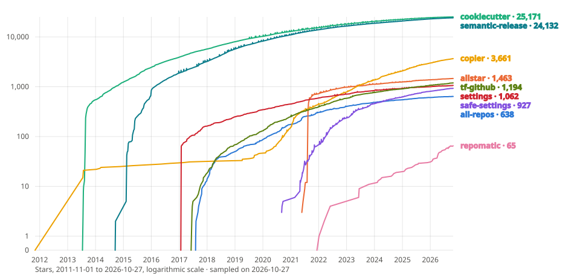

# {octicon}`trophy` Benchmark

<!-- Editing rules of this page:
     - A repomatic ✅ or 🪫 links the repomatic documentation of the feature. A competitor
       ✅ or 🪫 links what proves the support: its documentation, or the source line at the
       graded release.
     - A ❌ links explicit evidence that the project lacks or rejects the feature: an issue
       or pull request closed as not planned, a maintainer comment, a feature request left
       open, an official page stating the limit. Absence of the feature is never enough:
       with no citable source, the cell stays blank.
     - Verify each URL before committing it. Prefer an `#issuecomment-{id}` anchor where a
       maintainer states the position. -->

Repository automation tools span several domains: declarative settings management, project scaffolding, code quality enforcement, release pipelines, and cross-repo operations. No single tool covers all of these. This page compares `repomatic` against eight alternatives, each addressing a different part of the problem.

Every cell links to its evidence. A ✅ marks support built in, on by default or behind one documented switch. A 🪫 means the maintainer spends more energy, like writing a hook, installing a companion package or working around a partial feature. A ❌ links a statement that rules the feature out, like a maintainer's refusal, an open feature request or a documented limit. A blank cell means no citable source either way, or a row that does not apply.

## Repository management

| Feature                                           |                      `repomatic`                      | `cookiecutter`[^1] | `semantic-release`[^2] | `copier`[^3] |                             `allstar`[^4]                             |                                                          `tf-github`[^5]                                                          |                                         `settings`[^6]                                          |                                                        `safe-settings`[^7]                                                        | `all-repos`[^8] |
| ------------------------------------------------- | :---------------------------------------------------: | :----------------: | :--------------------: | :----------: | :-------------------------------------------------------------------: | :-------------------------------------------------------------------------------------------------------------------------------: | :---------------------------------------------------------------------------------------------: | :-------------------------------------------------------------------------------------------------------------------------------: | :-------------: |
| Repo settings (description, visibility, features) | [🪫](workflows.md#lint-repository-metadata-lint-repo) |                    |                        |              |                                                                       |           [✅](https://github.com/integrations/terraform-provider-github/blob/v6.13.0/docs/resources/repository.md#L9)            |  [✅](https://github.com/repository-settings/app/blob/v5.0.16/docs/plugins/repository.md#L22)   |                    [✅](https://github.com/github-community-projects/safe-settings/blob/3.0.0/README.md#L857)                     |                 |
| Branch protection / rulesets                      |        [🪫](security.md#supply-chain-security)        |                    |                        |              |    [✅](https://github.com/ossf/allstar/blob/v4.6/README.md#L342)     |       [✅](https://github.com/integrations/terraform-provider-github/blob/v6.13.0/docs/resources/branch_protection.md#L11)        |   [✅](https://github.com/repository-settings/app/blob/v5.0.16/docs/plugins/branches.md#L16)    |                    [✅](https://github.com/github-community-projects/safe-settings/blob/3.0.0/README.md#L865)                     |                 |
| Label management                                  |      [✅](workflows.md#sync-labels-sync-labels)       |                    |                        |              |                                                                       |          [✅](https://github.com/integrations/terraform-provider-github/blob/v6.13.0/docs/resources/issue_labels.md#L11)          |    [✅](https://github.com/repository-settings/app/blob/v5.0.16/docs/plugins/labels.md#L21)     |        [✅](https://github.com/github-community-projects/safe-settings/blob/3.0.0/docs/sample-settings/settings.yml#L106)         |                 |
| Collaborator / team management                    |                                                       |                    |                        |              |    [🪫](https://github.com/ossf/allstar/blob/v4.6/README.md#L467)     |    [✅](https://github.com/integrations/terraform-provider-github/blob/v6.13.0/docs/resources/repository_collaborators.md#L14)    | [✅](https://github.com/repository-settings/app/blob/v5.0.16/docs/plugins/collaborators.md#L13) |  [✅](https://github.com/github-community-projects/safe-settings/blob/3.0.0/docs/whitepaper-deploying-policies-at-scale.md#L100)  |                 |
| Org-wide settings inheritance                     |                                                       |                    |                        |              | [✅](https://github.com/ossf/allstar/blob/v4.6/manual-install.md#L61) |     [✅](https://github.com/integrations/terraform-provider-github/blob/v6.13.0/docs/resources/organization_settings.md#L72)      |     [🪫](https://github.com/repository-settings/app/blob/v5.0.16/docs/configuration.md#L22)     |                     [✅](https://github.com/github-community-projects/safe-settings/blob/3.0.0/README.md#L95)                     |                 |
| Security policy enforcement                       | [🪫](workflows.md#lint-repository-metadata-lint-repo) |                    |                        |              | [✅](https://github.com/ossf/allstar/blob/v4.6/manual-install.md#L84) | [🪫](https://github.com/integrations/terraform-provider-github/blob/v6.13.0/docs/resources/repository_vulnerability_alerts.md#L9) |  [🪫](https://github.com/repository-settings/app/blob/v5.0.16/docs/plugins/repository.md#L60)   | [🪫](https://github.com/github-community-projects/safe-settings/blob/3.0.0/docs/github-settings/1.%20repository-settings.md#L129) |                 |
| Repo metadata validation                          | [✅](workflows.md#lint-repository-metadata-lint-repo) |                    |                        |              |                                                                       |                                                                                                                                   |                                                                                                 |                    [🪫](https://github.com/github-community-projects/safe-settings/blob/3.0.0/README.md#L867)                     |                 |

`repomatic` checks repository metadata (homepage URL, description, package name consistency), rulesets and Actions settings via `lint-repo`, but does not create or modify GitHub settings. The declarative settings tools (`tf-github`, `settings`, `safe-settings`) can manage the full range of repo configuration. `allstar` checks branch protection and other policies, then logs each violation, opens an issue or, with its `fix` action, changes the setting.

## File sync & templates

| Feature                                     |                         `repomatic`                         |                                   `cookiecutter`[^1]                                    | `semantic-release`[^2] |                                   `copier`[^3]                                    | `allstar`[^4] |                                                  `tf-github`[^5]                                                  | `settings`[^6] |                                    `safe-settings`[^7]                                     |                             `all-repos`[^8]                             |
| ------------------------------------------- | :---------------------------------------------------------: | :-------------------------------------------------------------------------------------: | :--------------------: | :-------------------------------------------------------------------------------: | :-----------: | :---------------------------------------------------------------------------------------------------------------: | :------------: | :----------------------------------------------------------------------------------------: | :---------------------------------------------------------------------: |
| Project scaffolding                         |                 [✅](cli.md#repomatic-init)                 | [✅](https://github.com/cookiecutter/cookiecutter/blob/v2.7.1/cookiecutter/cli.py#L190) |                        |    [✅](https://github.com/copier-org/copier/blob/v9.19.1/copier/_cli.py#L98)     |               |  [✅](https://github.com/integrations/terraform-provider-github/blob/v6.13.0/docs/resources/repository.md#L116)   |                | [✅](https://github.com/github-community-projects/safe-settings/blob/3.0.0/README.md#L900) |                                                                         |
| Ongoing template sync                       |      [✅](workflows.md#sync-repomatic-sync-repomatic)       |  [❌](https://github.com/cookiecutter/cookiecutter/pull/1173#issuecomment-1590359189)   |                        |   [✅](https://github.com/copier-org/copier/blob/v9.19.1/docs/updating.md#L13)    |               |        [❌](https://github.com/integrations/terraform-provider-github/issues/2090#issuecomment-4876963661)        |                |                                                                                            |                                                                         |
| Template conflict resolution                |                                                             |  [❌](https://github.com/cookiecutter/cookiecutter/issues/784#issuecomment-674408178)   |                        |   [✅](https://github.com/copier-org/copier/blob/v9.19.1/docs/updating.md#L46)    |               |                                                                                                                   |                |                                                                                            |                                                                         |
| Template migration system                   |                                                             |                                                                                         |                        | [✅](https://github.com/copier-org/copier/blob/v9.19.1/docs/configuring.md#L1481) |               |                                                                                                                   |                |                                                                                            |                                                                         |
| Config file sync (gitignore, mailmap, etc.) |      [✅](workflows.md#sync-gitignore-sync-gitignore)       |                                                                                         |                        | [🪫](https://github.com/copier-org/copier/blob/v9.19.1/docs/configuring.md#L1193) |               | [✅](https://github.com/integrations/terraform-provider-github/blob/v6.13.0/docs/resources/repository_file.md#L9) |                |        [❌](https://github.com/github-community-projects/safe-settings/issues/287)         | [🪫](https://github.com/asottile/all-repos/blob/v1.33.0/README.md#L550) |
| Dependency lock management                  |           [✅](workflows.md#sync-uv-lock-updater)           |                                                                                         |                        |                                                                                   |               |                                                                                                                   |                |                                                                                            |                                                                         |
| Dependency graph generation                 | [✅](workflows.md#update-dependency-graph-update-dep-graph) |                                                                                         |                        |                                                                                   |               |                                                                                                                   |                |                                                                                            |                                                                         |
| Jinja2 templating                           |                                                             |     [✅](https://github.com/cookiecutter/cookiecutter/blob/v2.7.1/SECURITY.md#L20)      |                        |   [✅](https://github.com/copier-org/copier/blob/v9.19.1/docs/creating.md#L10)    |               |                                                                                                                   |                |                                                                                            |                                                                         |

`repomatic init` scaffolds projects with opinionated defaults (workflows, labels, tool configs, changelog) and keeps them in sync with the upstream canonical reference via version-pinned thin-caller workflows. `copier` has the most sophisticated update mechanism: Git-native conflict resolution (inline markers or `.rej` files) and a migrations system for breaking template changes. `cookiecutter` is strictly one-shot: generate and forget.

For config file sync, `copier` syncs files only as part of a full template update cycle, not standalone. `tf-github` can manage individual files via `github_repository_file`. `all-repos` can push file changes across repos via custom autofixers.

## Code quality

| Feature                         |                           `repomatic`                            | `cookiecutter`[^1] | `semantic-release`[^2] |                                `copier`[^3]                                 |                                     `allstar`[^4]                                     | `tf-github`[^5] | `settings`[^6] | `safe-settings`[^7] | `all-repos`[^8] |
| ------------------------------- | :--------------------------------------------------------------: | :----------------: | :--------------------: | :-------------------------------------------------------------------------: | :-----------------------------------------------------------------------------------: | :-------------: | :------------: | :-----------------: | :-------------: |
| Multi-language code formatting  |      [✅](workflows.md#github-workflows-autofix-yaml-jobs)       |                    |                        |                                                                             |                                                                                       |                 |                |                     |                 |
| Image optimization (PNG, JPEG)  |          [✅](workflows.md#format-images-format-images)          |                    |                        |                                                                             |                                                                                       |                 |                |                     |                 |
| Spell checking                  |              [✅](workflows.md#fix-typos-fix-typos)              |                    |                        |                                                                             |                                                                                       |                 |                |                     |                 |
| Static type checking (mypy)     |             [✅](workflows.md#lint-types-lint-types)             |                    |                        |                                                                             |                                                                                       |                 |                |                     |                 |
| YAML linting                    |              [✅](workflows.md#lint-yaml-lint-yaml)              |                    |                        |                                                                             |                                                                                       |                 |                |                     |                 |
| GitHub Actions security linting | [✅](workflows.md#lint-workflow-security-lint-workflow-security) |                    |                        |                                                                             |   [✅](https://github.com/ossf/allstar/blob/v4.6/pkg/policies/action/action.go#L15)   |                 |                |                     |                 |
| Link checking                   |     [✅](workflows.md#check-broken-links-check-broken-links)     |                    |                        |                                                                             |                                                                                       |                 |                |                     |                 |
| Credential scanning             |           [✅](workflows.md#lint-secrets-lint-secrets)           |                    |                        |                                                                             |                                                                                       |                 |                |                     |                 |
| Changelog linting               |              [✅](cli.md#repomatic-lint-changelog)               |                    |                        |                                                                             |                                                                                       |                 |                |                     |                 |
| Template staleness checking     |         [✅](workflows.md#sync-repomatic-sync-repomatic)         |                    |                        | [✅](https://github.com/copier-org/copier/blob/v9.19.1/copier/_cli.py#L479) |                                                                                       |                 |                |                     |                 |
| Dangerous workflow detection    | [✅](workflows.md#lint-workflow-security-lint-workflow-security) |                    |                        |                                                                             | [✅](https://github.com/ossf/allstar/blob/v4.6/pkg/policies/workflow/workflow.go#L15) |                 |                |                     |                 |

`repomatic` invokes 15+ tools (ruff, mypy, mdformat, shfmt, typos, biome, yamllint, actionlint, zizmor, lychee, gitleaks, oxipng, pyproject-fmt, labelmaker, autopep8, awesome-lint, shellcheck) through a unified `repomatic run <tool>` interface with automatic installation, platform-specific binary caching, and 4-level config precedence. No other tool in this benchmark bundles code quality tooling.

`allstar`'s security checks focus on repository-level policies (branch protection compliance, dangerous workflow patterns, binary artifacts in source) rather than linting individual files.

## Release automation

| Feature                                |                       `repomatic`                        | `cookiecutter`[^1] |                                     `semantic-release`[^2]                                     | `copier`[^3] | `allstar`[^4] |                                              `tf-github`[^5]                                               | `settings`[^6] | `safe-settings`[^7] | `all-repos`[^8] |
| -------------------------------------- | :------------------------------------------------------: | :----------------: | :--------------------------------------------------------------------------------------------: | :----------: | :-----------: | :--------------------------------------------------------------------------------------------------------: | :------------: | :-----------------: | :-------------: |
| Version computation from commits       |                                                          |                    |     [✅](https://github.com/semantic-release/semantic-release/blob/v25.0.9/README.md#L51)      |              |               |                                                                                                            |                |                     |                 |
| Manual version bumping                 |       [✅](workflows.md#bump-version-bump-version)       |                    | [❌](https://github.com/semantic-release/semantic-release/issues/1225#issuecomment-507434001)  |              |               |                                                                                                            |                |                     |                 |
| Changelog management                   | [✅](workflows.md#github-workflows-changelog-yaml-jobs)  |                    |          [🪫](https://github.com/semantic-release/changelog/blob/v7.0.0/README.md#L3)          |              |               | [🪫](https://github.com/integrations/terraform-provider-github/blob/v6.13.0/docs/resources/release.md#L68) |                |                     |                 |
| Git tagging                            |         [✅](workflows.md#create-tag-create-tag)         |                    |     [✅](https://github.com/semantic-release/semantic-release/blob/v25.0.9/README.md#L93)      |              |               | [🪫](https://github.com/integrations/terraform-provider-github/blob/v6.13.0/docs/resources/release.md#L58) |                |                     |                 |
| GitHub Releases                        |    [✅](workflows.md#publish-release-publish-release)    |                    |          [✅](https://github.com/semantic-release/github/blob/v12.0.10/README.md#L14)          |              |               | [✅](https://github.com/integrations/terraform-provider-github/blob/v6.13.0/docs/resources/release.md#L9)  |                |                     |                 |
| PyPI publishing                        |     [✅](workflows.md#publish-to-pypi-publish-pypi)      |                    |            [🪫](https://github.com/semantic-release/exec/blob/v7.1.0/README.md#L16)            |              |               |                                                                                                            |                |                     |                 |
| npm publishing                         |                                                          |                    |            [✅](https://github.com/semantic-release/npm/blob/v13.2.0/README.md#L3)             |              |               |                                                                                                            |                |                     |                 |
| Binary builds (standalone executables) |   [✅](workflows.md#compile-binaries-compile-binaries)   |                    |                                                                                                |              |               |                                                                                                            |                |                     |                 |
| SLSA provenance attestations           |         [✅](security.md#supply-chain-security)          |                    | [🪫](https://github.com/semantic-release/semantic-release/issues/2802#issuecomment-1684484968) |              |               |                                                                                                            |                |                     |                 |
| Release artifact scanning (VirusTotal) |    [✅](workflows.md#virustotal-scan-scan-virustotal)    |                    |                                                                                                |              |               |                                                                                                            |                |                     |                 |
| Multi-branch / pre-release channels    | [🪫](workflows.md#sync-dev-pre-release-sync-dev-release) |                    |     [✅](https://github.com/semantic-release/semantic-release/blob/v25.0.9/README.md#L39)      |              |               |                                                                                                            |                |                     |                 |

`semantic-release` automates the full release lifecycle from conventional commit messages: version computation, release notes, tagging, GitHub Release creation, and npm publishing. A separate official plugin writes a changelog file, and community plugins add PyPI support. `repomatic` takes a different approach: hand-curated changelogs with a freeze/unfreeze release cycle, manual version selection via `bump-my-version`, and a release workflow that covers PyPI publishing, Nuitka binary builds for 6 platform targets, SLSA attestations, and VirusTotal scanning.

`tf-github` creates GitHub Releases with the `github_release` resource, which can ask GitHub to generate the release notes, but it does not compute versions.

## CI/CD & operations

| Feature                            |                              `repomatic`                               | `cookiecutter`[^1] | `semantic-release`[^2] |                                 `copier`[^3]                                  |                  `allstar`[^4]                   |                                                          `tf-github`[^5]                                                          |                                   `settings`[^6]                                   |                             `safe-settings`[^7]                             | `all-repos`[^8] |
| ---------------------------------- | :--------------------------------------------------------------------: | :----------------: | :--------------------: | :---------------------------------------------------------------------------: | :----------------------------------------------: | :-------------------------------------------------------------------------------------------------------------------------------: | :--------------------------------------------------------------------------------: | :-------------------------------------------------------------------------: | :-------------: |
| Reusable workflow management       |                    [✅](workflows.md#example-usage)                    |                    |                        |                                                                               |                                                  | [🪫](https://github.com/integrations/terraform-provider-github/blob/v6.13.0/docs/resources/actions_repository_access_level.md#L9) |                                                                                    |                                                                             |                 |
| Workflow sync with drift detection |         [✅](workflows.md#lint-repository-metadata-lint-repo)          |                    |                        | [🪫](https://github.com/copier-org/copier/blob/v9.19.1/docs/updating.md#L288) |                                                  |         [🪫](https://github.com/integrations/terraform-provider-github/blob/v6.13.0/docs/resources/repository_file.md#L9)         |                                                                                    | [❌](https://github.com/github-community-projects/safe-settings/issues/287) |                 |
| Test matrix configuration          |                          [✅](test-matrix.md)                          |                    |                        |                                                                               |                                                  |                                                                                                                                   |                                                                                    |                                                                             |                 |
| CI secret management               |               [🪫](workflows.md#setup-guide-setup-guide)               |                    |                        |                                                                               |                                                  |         [✅](https://github.com/integrations/terraform-provider-github/blob/v6.13.0/docs/resources/actions_secret.md#L9)          |                                                                                    |                                                                             |                 |
| Actions permissions management     |         [🪫](workflows.md#lint-repository-metadata-lint-repo)          |                    |                        |                                                                               | [❌](https://github.com/ossf/allstar/issues/273) | [✅](https://github.com/integrations/terraform-provider-github/blob/v6.13.0/docs/resources/actions_repository_permissions.md#L9)  | [❌](https://github.com/repository-settings/app/issues/318#issuecomment-845992703) | [❌](https://github.com/github-community-projects/safe-settings/issues/656) |                 |
| Auto-lock inactive issues          |             [✅](workflows.md#lock-inactive-threads-lock)              |                    |                        |                                                                               |                                                  |                                                                                                                                   |                                                                                    |                                                                             |                 |
| Notification management            | [✅](workflows.md#unsubscribe-from-closed-threads-unsubscribe-threads) |                    |                        |                                                                               |                                                  |                                                                                                                                   |                                                                                    |                                                                             |                 |

`repomatic` manages the full CI/CD lifecycle: 12 reusable workflows (autofix, lint, test, release, docs, labels, changelog, etc.) deployed via thin-caller patterns, with drift detection against the upstream canonical reference. `tf-github` manages Actions infrastructure (secrets, variables, permissions, runner groups), and writes workflow files only through its generic `github_repository_file` resource.

## Multi-repo operations

| Feature                            |                   `repomatic`                    | `cookiecutter`[^1] | `semantic-release`[^2] |                                   `copier`[^3]                                    |                               `allstar`[^4]                                |                                                         `tf-github`[^5]                                                          |                                  `settings`[^6]                                   |                                        `safe-settings`[^7]                                         |                                               `all-repos`[^8]                                                |
| ---------------------------------- | :----------------------------------------------: | :----------------: | :--------------------: | :-------------------------------------------------------------------------------: | :------------------------------------------------------------------------: | :------------------------------------------------------------------------------------------------------------------------------: | :-------------------------------------------------------------------------------: | :------------------------------------------------------------------------------------------------: | :----------------------------------------------------------------------------------------------------------: |
| Org-wide policy enforcement        |                                                  |                    |                        |                                                                                   |       [✅](https://github.com/ossf/allstar/blob/v4.6/README.md#L225)       |     [✅](https://github.com/integrations/terraform-provider-github/blob/v6.13.0/docs/resources/organization_ruleset.md#L344)     | [❌](https://github.com/repository-settings/app/issues/95#issuecomment-928294512) |      [✅](https://github.com/github-community-projects/safe-settings/blob/3.0.0/README.md#L8)      |                                                                                                              |
| Cross-repo bulk changes            |                                                  |                    |                        |                                                                                   |                                                                            | [🪫](https://github.com/integrations/terraform-provider-github/blob/v6.13.0/docs/resources/app_installation_repositories.md#L13) | [❌](https://github.com/repository-settings/app/issues/95#issuecomment-928273555) |     [✅](https://github.com/github-community-projects/safe-settings/blob/3.0.0/README.md#L161)     |                   [✅](https://github.com/asottile/all-repos/blob/v1.33.0/README.md#L548)                    |
| Repository discovery               |                                                  |                    |                        |                                                                                   | [✅](https://github.com/ossf/allstar/blob/v4.6/pkg/enforce/enforce.go#L69) |        [✅](https://github.com/integrations/terraform-provider-github/blob/v6.13.0/docs/data-sources/repositories.md#L11)        |                                                                                   | [✅](https://github.com/github-community-projects/safe-settings/blob/3.0.0/lib/repoSelector.js#L4) |                   [✅](https://github.com/asottile/all-repos/blob/v1.33.0/README.md#L215)                    |
| Cross-repo search (grep, find)     |                                                  |                    |                        |                                                                                   |                                                                            |                                                                                                                                  |                                                                                   |                                                                                                    |                    [✅](https://github.com/asottile/all-repos/blob/v1.33.0/README.md#L76)                    |
| Automated PR creation across repos |                                                  |                    |                        |            [❌](https://github.com/copier-org/copier/discussions/1905)            |                                                                            |    [🪫](https://github.com/integrations/terraform-provider-github/blob/v6.13.0/docs/resources/repository_pull_request.md#L9)     |                                                                                   |                                                                                                    |                   [✅](https://github.com/asottile/all-repos/blob/v1.33.0/README.md#L471)                    |
| Upstream workflow sync (per-repo)  | [✅](workflows.md#sync-repomatic-sync-repomatic) |                    |                        | [🪫](https://github.com/copier-org/copier/blob/v9.19.1/docs/configuring.md#L2015) |                                                                            |        [🪫](https://github.com/integrations/terraform-provider-github/blob/v6.13.0/docs/resources/repository_file.md#L9)         |                                                                                   |            [❌](https://github.com/github-community-projects/safe-settings/issues/287)             | [🪫](https://github.com/asottile/all-repos/blob/v1.33.0/all_repos/autofix/azure_pipelines_autoupdate.py#L73) |

`all-repos` is the only tool focused on operating across many repositories at once: clone all repos in an org, search across them, and apply bulk changes with automated PR creation. `repomatic` syncs downstream repos with the upstream canonical reference via version-pinned thin-caller workflows, but each downstream repo manages its own sync independently.

## Unique strengths

- **All-in-one Python CLI**: `repomatic` is the only tool in this benchmark that combines file sync, multi-language code formatting, linting, release management, and CI/CD workflow maintenance in a single installable CLI. Every other tool focuses on one or two of these areas.
- **Tool runner with config resolution**: the `repomatic run <tool>` interface provides unified invocation for 15+ tools with automatic installation, platform-specific binary caching, and 4-level configuration precedence (native config file, `[tool.X]` in pyproject.toml, bundled defaults, bare invocation).
- **Minimal supply chain surface**: [23 third-party GitHub Actions eliminated](security.md#third-party-action-minimization), [10 Python linters/formatters consolidated into ruff](security.md#ruff-consolidation), and [5 packaging tools consolidated into uv](security.md#uv-consolidation). Only 1 third-party action remains (of 8 total). Every other tool in this benchmark that uses GitHub Actions relies on third-party action ecosystems without equivalent reduction.
- **Binary builds and supply chain attestations**: Nuitka compilation produces standalone executables for 6 platform targets (Linux/macOS/Windows, x64/ARM64) with SLSA provenance attestations and VirusTotal scanning of release artifacts. No other tool in this benchmark provides binary builds.
- **Changelog lifecycle**: hand-curated changelogs with a freeze/unfreeze release cycle, producing human-written release notes rather than auto-generated commit logs.
- **pyproject.toml-native configuration**: all settings live in `[tool.repomatic]` with schema-aware dataclass support, field-level documentation, and CLI flag overrides.

## Gaps and opportunities

### Branch protection management

`tf-github`, `settings`, and `safe-settings` can declaratively create and modify branch protection rules and rulesets. `allstar` checks compliance, then opens an issue or applies its `fix` action when protection is missing. `repomatic`'s `lint-repo` warns when no branch ruleset is active, but does not create one.

### Template conflict resolution

`copier` resolves conflicts during template updates with inline conflict markers or `.rej` sidecar files, and adds a migrations system for breaking template changes across versions. `repomatic`'s file sync is convergent (applying the same operation twice is a no-op) but does not surface conflicts interactively when upstream and local changes collide.

### Org-wide settings inheritance

`safe-settings` defines org-level defaults in `.github/settings.yml` with per-repo overrides, applying settings across all repos in an organization from a single configuration source. `repomatic` operates per-repository: downstream repos opt into upstream conventions by deploying thin-caller workflows pinned to a version tag.

### Commit-based version computation

`semantic-release` automatically determines the next semver version by analyzing conventional commit messages, with support for pre-release channels and multi-branch releases. `repomatic` uses `bump-my-version` for manual version bumping, giving the maintainer full control over version selection at the cost of automation.

## Activity

| Metrics                      |                                                `repomatic`                                                 |                                                `cookiecutter`[^1]                                                |                                                  `semantic-release`[^2]                                                  |                                               `copier`[^3]                                               |                                            `allstar`[^4]                                            |                                                        `tf-github`[^5]                                                        |                                                 `settings`[^6]                                                 |                                                      `safe-settings`[^7]                                                       |                                              `all-repos`[^8]                                              |
| ---------------------------- | :--------------------------------------------------------------------------------------------------------: | :--------------------------------------------------------------------------------------------------------------: | :----------------------------------------------------------------------------------------------------------------------: | :------------------------------------------------------------------------------------------------------: | :-------------------------------------------------------------------------------------------------: | :---------------------------------------------------------------------------------------------------------------------------: | :------------------------------------------------------------------------------------------------------------: | :----------------------------------------------------------------------------------------------------------------------------: | :-------------------------------------------------------------------------------------------------------: |
| Watchers                     |           |           |           |           |           |           |           |           |           |
| Contributors                 |       |       |       |       |       |       |       |       |       |
| Commit activity              |  |  |  |  |  |  |  |  |  |
| Commits since latest release |         |         |         |         |         |         |         |         |         |
| Last release date            |       |       |       |       |       |       |       |       |       |
| Last commit                  |        |        |        |        |        |        |        |        |        |
| Open issues                  |             |             |             |             |             |             |             |             |             |
| Open PRs                     |          |          |          |          |          |          |          |          |          |

## Popularity



The vertical axis counts by powers of ten. The largest alternative here holds two orders of magnitude more stars than `repomatic`, and a linear axis draws every other project flat along the bottom edge.

GitHub restricted its stargazer endpoints to a repository's own admins in June 2026, which left every third-party star chart on the web rendering an error card. It reopened an anonymous star history in September. [`repomatic sample-metrics`](https://github.com/kdeldycke/repomatic/blob/main/repomatic/metrics/store.py) reads every project on this page every quarter into [`metrics.csv`](assets/metrics.csv), so the history accrues here and cannot be revoked a second time.

Every curve is reconstructed from the stars its repository *still* holds, dated to the week each was given, and runs back to that repository's creation. So a curve understates every past week by the stars withdrawn since, and converges on the true figure at the right edge: read a sagging stretch as a project shedding followers, which a monotonic chart would hide. The star counts below are live in every case. See [History](history.md) for `repomatic`'s own curve on its own scale.

| Metrics         |                                                             `repomatic`                                                              |                                                           `cookiecutter`[^1]                                                            |                                                           `semantic-release`[^2]                                                           |                                                           `copier`[^3]                                                            |                                      `allstar`[^4]                                      |                                                  `tf-github`[^5]                                                  |                                           `settings`[^6]                                           |                                                `safe-settings`[^7]                                                 |                                                           `all-repos`[^8]                                                            |
| --------------- | :----------------------------------------------------------------------------------------------------------------------------------: | :-------------------------------------------------------------------------------------------------------------------------------------: | :----------------------------------------------------------------------------------------------------------------------------------------: | :-------------------------------------------------------------------------------------------------------------------------------: | :-------------------------------------------------------------------------------------: | :---------------------------------------------------------------------------------------------------------------: | :------------------------------------------------------------------------------------------------: | :----------------------------------------------------------------------------------------------------------------: | :----------------------------------------------------------------------------------------------------------------------------------: |
| Stars           |                                        |                                     |                                |                                       |  |  |  |  |                                         |
| SourceRank      |                  |                  |                  |                  |                                            -                                            |                                                         -                                                         |                                                 -                                                  |                                                         -                                                          |                  |
| Dependent repos |  |  |  |  |                                            -                                            |                                                         -                                                         |                                                 -                                                  |                                                         -                                                          |  |

## Distribution

| Registry         |                                                                                 `repomatic`                                                                                  |                                                                                    `cookiecutter`[^1]                                                                                    |                                                                                          `semantic-release`[^2]                                                                                          |                                                                               `copier`[^3]                                                                               |                                                                         `allstar`[^4]                                                                          |                                                                                                  `tf-github`[^5]                                                                                                   |                                                                                    `settings`[^6]                                                                                    |                                                                                                 `safe-settings`[^7]                                                                                                  |                                                                              `all-repos`[^8]                                                                               |
| ---------------- | :--------------------------------------------------------------------------------------------------------------------------------------------------------------------------: | :--------------------------------------------------------------------------------------------------------------------------------------------------------------------------------------: | :------------------------------------------------------------------------------------------------------------------------------------------------------------------------------------------------------: | :----------------------------------------------------------------------------------------------------------------------------------------------------------------------: | :------------------------------------------------------------------------------------------------------------------------------------------------------------: | :----------------------------------------------------------------------------------------------------------------------------------------------------------------------------------------------------------------: | :----------------------------------------------------------------------------------------------------------------------------------------------------------------------------------: | :------------------------------------------------------------------------------------------------------------------------------------------------------------------------------------------------------------------: | :------------------------------------------------------------------------------------------------------------------------------------------------------------------------: |
| PyPI             |                             [](https://pypi.org/project/repomatic/)                              |                                [](https://pypi.org/project/cookiecutter/)                                 |                                                                                                    -                                                                                                     |                              [](https://pypi.org/project/copier/)                               |                                                                               -                                                                                |                                                                                                         -                                                                                                          |                                                                                          -                                                                                           |                                                                                                          -                                                                                                           |                            [](https://pypi.org/project/all-repos/)                             |
| npm              |                                                                                      -                                                                                       |                                                                                            -                                                                                             |                                   [](https://www.npmjs.com/package/semantic-release)                                    |                                                                                    -                                                                                     |                                                                               -                                                                                |                                                                                                         -                                                                                                          |                                                                                          -                                                                                           |                                                                                                          -                                                                                                           |                                                                                     -                                                                                      |
| PyPI downloads   |                        [](https://pypi.org/project/repomatic/)                        |                           [](https://pypi.org/project/cookiecutter/)                           |                                                                                                    -                                                                                                     |                         [](https://pypi.org/project/copier/)                         |                                                                               -                                                                                |                                                                                                         -                                                                                                          |                                                                                          -                                                                                           |                                                                                                          -                                                                                                           |                       [](https://pypi.org/project/all-repos/)                       |
| npm downloads    |                                                                                      -                                                                                       |                                                                                            -                                                                                             |                              [](https://www.npmjs.com/package/semantic-release)                              |                                                                                    -                                                                                     |                                                                               -                                                                                |                                                                                                         -                                                                                                          |                                                                                          -                                                                                           |                                                                                                          -                                                                                                           |                                                                                     -                                                                                      |
| GitHub downloads | [](https://github.com/kdeldycke/repomatic/releases) | [](https://github.com/cookiecutter/cookiecutter/releases) | [](https://github.com/semantic-release/semantic-release/releases) | [](https://github.com/copier-org/copier/releases) | [](https://github.com/ossf/allstar/releases) | [](https://github.com/integrations/terraform-provider-github/releases) | [](https://github.com/repository-settings/app/releases) | [](https://github.com/github-community-projects/safe-settings/releases) | [](https://github.com/asottile/all-repos/releases) |

## Metadata

| Metadata         |                                           `repomatic`                                            |                                           `cookiecutter`[^1]                                           |                                             `semantic-release`[^2]                                             |                                          `copier`[^3]                                          |                                       `allstar`[^4]                                       |                                                   `tf-github`[^5]                                                   |                                            `settings`[^6]                                            |                                                 `safe-settings`[^7]                                                  |                                         `all-repos`[^8]                                         |
| ---------------- | :----------------------------------------------------------------------------------------------: | :----------------------------------------------------------------------------------------------------: | :------------------------------------------------------------------------------------------------------------: | :--------------------------------------------------------------------------------------------: | :---------------------------------------------------------------------------------------: | :-----------------------------------------------------------------------------------------------------------------: | :--------------------------------------------------------------------------------------------------: | :------------------------------------------------------------------------------------------------------------------: | :---------------------------------------------------------------------------------------------: |
| License          |  |  |  |  |  |  |  |  |  |
| Main language    |                                              Python                                              |                                                 Python                                                 |                                                   JavaScript                                                   |                                             Python                                             |                                            Go                                             |                                                         Go                                                          |                                              JavaScript                                              |                                                      JavaScript                                                      |                                             Python                                              |
| Deployment model |                                               CLI                                                |                                              CLI, library                                              |                                                 CLI (Node.js)                                                  |                                          CLI, library                                          |                                  Self-hosted GitHub App                                   |                                                 Terraform provider                                                  |                                              GitHub App                                              |                                                      GitHub App                                                      |                                               CLI                                               |
| Configuration    |                                         `pyproject.toml`                                         |                                          `cookiecutter.json`                                           |                                                  `.releaserc`                                                  |                                         `copier.yaml`                                          |                                        `.allstar/`                                        |                                                     `.tf` (HCL)                                                     |                                        `.github/settings.yml`                                        |                                                `.github/settings.yml`                                                |                                        `all-repos.json`                                         |
| Benchmark date   |                                            2026-11-03                                            |                                               2026-11-03                                               |                                                   2026-11-03                                                   |                                           2026-11-03                                           |                                        2026-11-03                                         |                                                     2026-11-03                                                      |                                              2026-11-03                                              |                                                      2026-11-03                                                      |                                           2026-11-03                                            |

## Excluded projects

```{note}
[`cruft`](https://github.com/cruft/cruft) (about 1,600 stars) is not included because it has had no commit since its `2.16.0` release on 2024-12-25. [cruft/cruft#343](https://github.com/cruft/cruft/issues/343), which asks about the future of the project, is still open.
```

## Project URLs

[^1]: [https://github.com/cookiecutter/cookiecutter](https://github.com/cookiecutter/cookiecutter)

[^2]: [https://github.com/semantic-release/semantic-release](https://github.com/semantic-release/semantic-release)

[^3]: [https://github.com/copier-org/copier](https://github.com/copier-org/copier)

[^4]: [https://github.com/ossf/allstar](https://github.com/ossf/allstar)

[^5]: [https://github.com/integrations/terraform-provider-github](https://github.com/integrations/terraform-provider-github)

[^6]: [https://github.com/repository-settings/app](https://github.com/repository-settings/app)

[^7]: [https://github.com/github-community-projects/safe-settings](https://github.com/github-community-projects/safe-settings)

[^8]: [https://github.com/asottile/all-repos](https://github.com/asottile/all-repos)
